# Blocker board

**Generated automatically. Don't edit this file.** It rebuilds when issues change or anything merges to main, and every 10 minutes. Dependencies come from the **Blocked by** column in [`docs/tracks/`](https://github.com/SoroushRF/Rehearsal/tree/main/docs/tracks); change them there through a PR.

Legend: ✅ done · 👀 in review · 🔨 in progress · 🟨 ready · 🟥 blocked

## Top blockers

41 of 56 tasks done. These open tasks hold up the most other work:

| Task | Track owner | Status | Open tasks waiting on it |
|---|---|---|---|
| **T2.15** Review UI: show the Slack summary step and its exact text [#145](https://github.com/SoroushRF/Rehearsal/issues/145) | @parsaabbasian | 🟨 ready | 1 |
| **T2.16** Review UI: show the exact rendered public reply being approved [#146](https://github.com/SoroushRF/Rehearsal/issues/146) | @parsaabbasian | 🟨 ready | 1 |
| **T2.18** Policy: choose a refund or an invoice credit per obligation [#148](https://github.com/SoroushRF/Rehearsal/issues/148) | @parsaabbasian | 🟨 ready | 1 |
| **T3.10** Slack write adapter and uncertain-post reconciliation [#149](https://github.com/SoroushRF/Rehearsal/issues/149) | @ArtinMe | 👀 in review | 1 |
| **T4.10** Guard: one remedy per obligation across refunds and credits [#152](https://github.com/SoroushRF/Rehearsal/issues/152) | @skhdemo | 👀 in review | 1 |

## T1 Rehearse

**Owner:** @SoroushRF

| Task | Status | Blocked by | Blocks |
|---|---|---|---|
| **T1.1** Era day-one gate: conformance tests and capability matrix [#2](https://github.com/SoroushRF/Rehearsal/issues/2) | ✅ done |  | T1.2, T1.3, T1.9 |
| **T1.2** Seed the incident cohort into both worlds, plus demo:reset [#3](https://github.com/SoroushRF/Rehearsal/issues/3) | ✅ done |  | T1.5 |
| **T1.3** Read adapters: charges, tickets and query predicates [#4](https://github.com/SoroushRF/Rehearsal/issues/4) | ✅ done |  | T1.4, T4.3 (T4) |
| **T1.4** Typed planning tools that record evidence and dependency edges [#5](https://github.com/SoroushRF/Rehearsal/issues/5) | ✅ done |  | T1.5 |
| **T1.5** Bounded Claude tool loop and planner-worker plan jobs [#6](https://github.com/SoroushRF/Rehearsal/issues/6) | ✅ done |  | T1.6, T1.7, T1.8, T1.15, T2.5 (T2), T2.10 (T2) |
| **T1.6** ~20 benign and trap tasks plus baselines for the scorecard [#7](https://github.com/SoroushRF/Rehearsal/issues/7) | ✅ done |  |  |
| **T1.7** Slack summary step (slack.message.postSummary) _(stretch)_ [#8](https://github.com/SoroushRF/Rehearsal/issues/8) | 🟥 blocked | T2.15 (T2, ready) T3.10 (T3, in review) |  |
| **T1.8** SurrealDB precedents (explicit promotion, recall with trace) [#9](https://github.com/SoroushRF/Rehearsal/issues/9) | ✅ done |  | T2.17 (T2) |
| **T1.9** Signed Era tenant tokens in both workers [#39](https://github.com/SoroushRF/Rehearsal/issues/39) | ✅ done |  | T1.2, T1.5, T3.3 (T3), T4.3 (T4) |
| **T1.10** Bind duplicate refunds to invoice identity and retain a paid anchor [#61](https://github.com/SoroushRF/Rehearsal/issues/61) | ✅ done |  |  |
| **T1.11** Verify customer ownership before proposing ticket changes [#63](https://github.com/SoroushRF/Rehearsal/issues/63) | ✅ done |  |  |
| **T1.12** Preserve the evidence snapshot used to construct each action [#73](https://github.com/SoroushRF/Rehearsal/issues/73) | ✅ done |  |  |
| **T1.13** Public customer reply from an exact approved template [#136](https://github.com/SoroushRF/Rehearsal/issues/136) | 🟥 blocked | T2.16 (T2, ready) |  |
| **T1.14** Invoice-balance credit as an alternative remedy to a refund [#137](https://github.com/SoroushRF/Rehearsal/issues/137) | 🟥 blocked | T2.18 (T2, ready) T4.10 (T4, in review) |  |
| **T1.15** Scorecard rows from a real model planner (T1.6 follow-up) [#140](https://github.com/SoroushRF/Rehearsal/issues/140) | ✅ done |  |  |
| **T1.16** Full-scope decision record: reopen the trimmed scope [#141](https://github.com/SoroushRF/Rehearsal/issues/141) | ✅ done |  | T1.8, T1.17, T1.18, T1.19 |
| **T1.17** Contracts: typed op slack.message.postSummary [#142](https://github.com/SoroushRF/Rehearsal/issues/142) | ✅ done |  | T1.7, T2.15 (T2), T3.10 (T3) |
| **T1.18** Contracts: typed op zendesk.ticket.appendPublicReply [#143](https://github.com/SoroushRF/Rehearsal/issues/143) | ✅ done |  | T1.13, T2.16 (T2), T3.11 (T3) |
| **T1.19** Contracts: typed op stripe.customer.balanceCredit (after an Era semantics check) [#144](https://github.com/SoroushRF/Rehearsal/issues/144) | ✅ done |  | T1.14, T2.18 (T2), T3.12 (T3), T4.10 (T4) |

## T2 Review & Approve

**Owner:** @parsaabbasian

| Task | Status | Blocked by | Blocks |
|---|---|---|---|
| **T2.1** Plan diff view from fixture bundles [#10](https://github.com/SoroushRF/Rehearsal/issues/10) | ✅ done |  |  |
| **T2.2** API: store plans, get plan, create revisions with expected-hash check [#11](https://github.com/SoroushRF/Rehearsal/issues/11) | ✅ done |  | T2.4, T2.5 |
| **T2.3** Clerk sign-in, support_lead / finance_lead roles, and server-side checks [#12](https://github.com/SoroushRF/Rehearsal/issues/12) | ✅ done |  | T2.4 |
| **T2.4** Approvals endpoint: hash-bound grant and refusal test matrix [#13](https://github.com/SoroushRF/Rehearsal/issues/13) | ✅ done |  | T2.8 |
| **T2.5** Deploy thin slice and prove cloud workers reach the simulators [#14](https://github.com/SoroushRF/Rehearsal/issues/14) | 🟨 ready | — |  |
| **T2.6** Run timeline, receipts and held-step views (polling GET /api/runs/:id/events) [#15](https://github.com/SoroushRF/Rehearsal/issues/15) | ✅ done |  | T2.7 |
| **T2.7** Two-minute video script, recording, Devpost page [#16](https://github.com/SoroushRF/Rehearsal/issues/16) | 🟨 ready | — |  |
| **T2.8** Thin Expo approver app on the same API _(stretch)_ [#17](https://github.com/SoroushRF/Rehearsal/issues/17) | 🟨 ready | — |  |
| **T2.9** Decide currency: align policy.v1.json with the Era seed (USD vs CAD) [#40](https://github.com/SoroushRF/Rehearsal/issues/40) | ✅ done |  | T1.5 (T1) |
| **T2.10** Rehearse button: start a plan from the review page and follow it [#116](https://github.com/SoroushRF/Rehearsal/issues/116) | ✅ done |  |  |
| **T2.11** Saved run replay that opens without signing in [#118](https://github.com/SoroushRF/Rehearsal/issues/118) | ✅ done |  |  |
| **T2.12** Receipt wording: don't say "read back" for write-response confirmations [#132](https://github.com/SoroushRF/Rehearsal/issues/132) | 🟨 ready | — |  |
| **T2.13** Two distinct approvers where policy requires (support + finance) [#135](https://github.com/SoroushRF/Rehearsal/issues/135) | 🟨 ready | — |  |
| **T2.14** Historical audit view: the exact plan and policy as approved [#138](https://github.com/SoroushRF/Rehearsal/issues/138) | 🟨 ready | — |  |
| **T2.15** Review UI: show the Slack summary step and its exact text [#145](https://github.com/SoroushRF/Rehearsal/issues/145) | 🟨 ready | — | T1.7 (T1) |
| **T2.16** Review UI: show the exact rendered public reply being approved [#146](https://github.com/SoroushRF/Rehearsal/issues/146) | 🟨 ready | — | T1.13 (T1) |
| **T2.17** Precedent promotion: finance-only route and UI [#147](https://github.com/SoroushRF/Rehearsal/issues/147) | 🟨 ready | — |  |
| **T2.18** Policy: choose a refund or an invoice credit per obligation [#148](https://github.com/SoroushRF/Rehearsal/issues/148) | 🟨 ready | — | T1.14 (T1) |

## T3 Apply

**Owner:** @ArtinMe

| Task | Status | Blocked by | Blocks |
|---|---|---|---|
| **T3.1** Drizzle migrations, Postgres journal, pg-boss, apply endpoint [#18](https://github.com/SoroushRF/Rehearsal/issues/18) | ✅ done |  | T2.2 (T2), T3.2 |
| **T3.2** Executor loop on a FakeProvider [#19](https://github.com/SoroushRF/Rehearsal/issues/19) | ✅ done |  | T2.5 (T2), T2.6 (T2), T3.3, T4.3 (T4) |
| **T3.3** Write adapters: Stripe refund, Zendesk patch, private note [#20](https://github.com/SoroushRF/Rehearsal/issues/20) | ✅ done |  | T3.4, T3.6, T4.3 (T4), T4.4 (T4) |
| **T3.4** Retries with bounded backoff and Retry-After [#21](https://github.com/SoroushRF/Rehearsal/issues/21) | ✅ done |  | T3.5 |
| **T3.5** Unknown outcome: lost response, restart, reconcile through reads [#22](https://github.com/SoroushRF/Rehearsal/issues/22) | ✅ done |  | T3.7 |
| **T3.6** ID divergence test, partial-completion state, cancellation [#23](https://github.com/SoroushRF/Rehearsal/issues/23) | ✅ done |  | T3.7 |
| **T3.7** Bounded concurrency across independent cases [#24](https://github.com/SoroushRF/Rehearsal/issues/24) | ✅ done |  |  |
| **T3.8** Read back each write before confirming its receipt [#134](https://github.com/SoroushRF/Rehearsal/issues/134) | ✅ done |  | T1.14 (T1) |
| **T3.10** Slack write adapter and uncertain-post reconciliation [#149](https://github.com/SoroushRF/Rehearsal/issues/149) | 👀 in review [PR #195](https://github.com/SoroushRF/Rehearsal/pull/195) | — | T1.7 (T1) |
| **T3.11** Zendesk public reply write adapter and reconciliation [#150](https://github.com/SoroushRF/Rehearsal/issues/150) | ✅ done |  | T1.13 (T1) |
| **T3.12** Stripe balance credit write adapter and reconciliation [#151](https://github.com/SoroushRF/Rehearsal/issues/151) | ✅ done |  | T1.14 (T1) |

## T4 Guard

**Owner:** @skhdemo

| Task | Status | Blocked by | Blocks |
|---|---|---|---|
| **T4.1** Pure guards: observation compare, query-membership diff, own-write overlay [#25](https://github.com/SoroushRF/Rehearsal/issues/25) | ✅ done |  | T4.3 |
| **T4.2** Injection scripts and demo:phantom / demo:conflict / demo:reset [#26](https://github.com/SoroushRF/Rehearsal/issues/26) | ✅ done |  | T1.6 (T1), T4.3 |
| **T4.3** Wire guards into executor admission [#27](https://github.com/SoroushRF/Rehearsal/issues/27) | ✅ done |  | T4.4 |
| **T4.4** Conditional compensation on owned fields [#28](https://github.com/SoroushRF/Rehearsal/issues/28) | ✅ done |  |  |
| **T4.5** ML smoke test: Qwen3.5-0.8B LoRA on 32 cases [#29](https://github.com/SoroushRF/Rehearsal/issues/29) | ✅ done |  | T4.6 |
| **T4.6** ML pilot and go/no-go [#30](https://github.com/SoroushRF/Rehearsal/issues/30) | ✅ done |  | T4.7 |
| **T4.7** Impact service behind ImpactPort (if ML go) [#31](https://github.com/SoroushRF/Rehearsal/issues/31) | ✅ done |  |  |
| **T4.10** Guard: one remedy per obligation across refunds and credits [#152](https://github.com/SoroushRF/Rehearsal/issues/152) | 👀 in review [PR #199](https://github.com/SoroushRF/Rehearsal/pull/199) | — | T1.14 (T1) |

## Task graph

An arrow `A --> B` means B waits on A. Stretch tasks are left out.

```mermaid
flowchart LR
  classDef done fill:#d3f9d8,stroke:#2b8a3e,color:#1b4332
  classDef review fill:#d0ebff,stroke:#1971c2,color:#0b3460
  classDef progress fill:#e5dbff,stroke:#5f3dc4,color:#2b1a66
  classDef ready fill:#fff3bf,stroke:#e67700,color:#5c3c00
  classDef blocked fill:#ffe3e3,stroke:#c92a2a,color:#5c0a0a
  subgraph T1[T1 Rehearse]
    T1_1["T1.1 Era day-one gate: conformance tests and cap"]:::done
    T1_2["T1.2 Seed the incident cohort into both worlds, "]:::done
    T1_3["T1.3 Read adapters: charges, tickets and query p"]:::done
    T1_4["T1.4 Typed planning tools that record evidence a"]:::done
    T1_5["T1.5 Bounded Claude tool loop and planner-worker"]:::done
    T1_6["T1.6 ~20 benign and trap tasks plus baselines fo"]:::done
    T1_8["T1.8 SurrealDB precedents (explicit promotion, r"]:::done
    T1_9["T1.9 Signed Era tenant tokens in both workers"]:::done
    T1_10["T1.10 Bind duplicate refunds to invoice identity"]:::done
    T1_11["T1.11 Verify customer ownership before proposing"]:::done
    T1_12["T1.12 Preserve the evidence snapshot used to con"]:::done
    T1_13["T1.13 Public customer reply from an exact approv"]:::blocked
    T1_14["T1.14 Invoice-balance credit as an alternative r"]:::blocked
    T1_15["T1.15 Scorecard rows from a real model planner ("]:::done
    T1_16["T1.16 Full-scope decision record: reopen the tri"]:::done
    T1_17["T1.17 Contracts: typed op slack.message.postSumm"]:::done
    T1_18["T1.18 Contracts: typed op zendesk.ticket.appendP"]:::done
    T1_19["T1.19 Contracts: typed op stripe.customer.balanc"]:::done
  end
  subgraph T2[T2 Review & Approve]
    T2_1["T2.1 Plan diff view from fixture bundles"]:::done
    T2_2["T2.2 API: store plans, get plan, create revision"]:::done
    T2_3["T2.3 Clerk sign-in, support_lead / finance_lead "]:::done
    T2_4["T2.4 Approvals endpoint: hash-bound grant and re"]:::done
    T2_5["T2.5 Deploy thin slice and prove cloud workers r"]:::ready
    T2_6["T2.6 Run timeline, receipts and held-step views "]:::done
    T2_7["T2.7 Two-minute video script, recording, Devpost"]:::ready
    T2_9["T2.9 Decide currency: align policy.v1.json with "]:::done
    T2_10["T2.10 Rehearse button: start a plan from the rev"]:::done
    T2_11["T2.11 Saved run replay that opens without signin"]:::done
    T2_12["T2.12 Receipt wording: don't say read back for w"]:::ready
    T2_13["T2.13 Two distinct approvers where policy requir"]:::ready
    T2_14["T2.14 Historical audit view: the exact plan and "]:::ready
    T2_15["T2.15 Review UI: show the Slack summary step and"]:::ready
    T2_16["T2.16 Review UI: show the exact rendered public "]:::ready
    T2_17["T2.17 Precedent promotion: finance-only route an"]:::ready
    T2_18["T2.18 Policy: choose a refund or an invoice cred"]:::ready
  end
  subgraph T3[T3 Apply]
    T3_1["T3.1 Drizzle migrations, Postgres journal, pg-bo"]:::done
    T3_2["T3.2 Executor loop on a FakeProvider"]:::done
    T3_3["T3.3 Write adapters: Stripe refund, Zendesk patc"]:::done
    T3_4["T3.4 Retries with bounded backoff and Retry-Afte"]:::done
    T3_5["T3.5 Unknown outcome: lost response, restart, re"]:::done
    T3_6["T3.6 ID divergence test, partial-completion stat"]:::done
    T3_7["T3.7 Bounded concurrency across independent case"]:::done
    T3_8["T3.8 Read back each write before confirming its "]:::done
    T3_10["T3.10 Slack write adapter and uncertain-post rec"]:::review
    T3_11["T3.11 Zendesk public reply write adapter and rec"]:::done
    T3_12["T3.12 Stripe balance credit write adapter and re"]:::done
  end
  subgraph T4[T4 Guard]
    T4_1["T4.1 Pure guards: observation compare, query-mem"]:::done
    T4_2["T4.2 Injection scripts and demo:phantom / demo:c"]:::done
    T4_3["T4.3 Wire guards into executor admission"]:::done
    T4_4["T4.4 Conditional compensation on owned fields"]:::done
    T4_5["T4.5 ML smoke test: Qwen3.5-0.8B LoRA on 32 case"]:::done
    T4_6["T4.6 ML pilot and go/no-go"]:::done
    T4_7["T4.7 Impact service behind ImpactPort (if ML go)"]:::done
    T4_10["T4.10 Guard: one remedy per obligation across re"]:::review
  end
  T1_1 --> T1_2
  T1_9 --> T1_2
  T1_1 --> T1_3
  T1_3 --> T1_4
  T1_2 --> T1_5
  T1_4 --> T1_5
  T1_9 --> T1_5
  T2_9 --> T1_5
  T1_5 --> T1_6
  T4_2 --> T1_6
  T1_5 --> T1_8
  T1_16 --> T1_8
  T1_1 --> T1_9
  T1_18 --> T1_13
  T2_16 --> T1_13
  T3_11 --> T1_13
  T1_19 --> T1_14
  T2_18 --> T1_14
  T3_12 --> T1_14
  T4_10 --> T1_14
  T3_8 --> T1_14
  T1_5 --> T1_15
  T1_16 --> T1_17
  T1_16 --> T1_18
  T1_16 --> T1_19
  T3_1 --> T2_2
  T2_2 --> T2_4
  T2_3 --> T2_4
  T2_2 --> T2_5
  T1_5 --> T2_5
  T3_2 --> T2_5
  T3_2 --> T2_6
  T2_6 --> T2_7
  T1_5 --> T2_10
  T1_17 --> T2_15
  T1_18 --> T2_16
  T1_8 --> T2_17
  T1_19 --> T2_18
  T3_1 --> T3_2
  T3_2 --> T3_3
  T1_9 --> T3_3
  T3_3 --> T3_4
  T3_4 --> T3_5
  T3_3 --> T3_6
  T3_5 --> T3_7
  T3_6 --> T3_7
  T1_17 --> T3_10
  T1_18 --> T3_11
  T1_19 --> T3_12
  T4_1 --> T4_3
  T4_2 --> T4_3
  T3_2 --> T4_3
  T1_3 --> T4_3
  T3_3 --> T4_3
  T1_9 --> T4_3
  T4_3 --> T4_4
  T3_3 --> T4_4
  T4_5 --> T4_6
  T4_6 --> T4_7
  T1_19 --> T4_10
```

