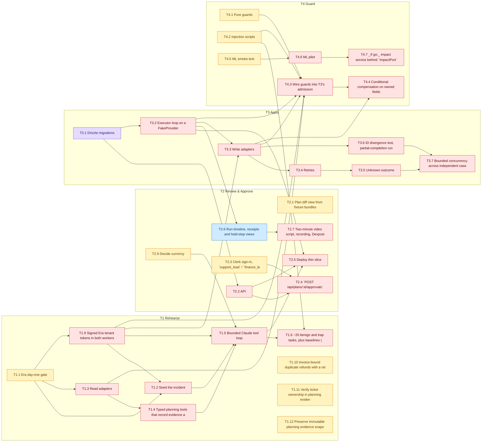

# Blocker board

**Generated automatically. Don't edit this file.** It rebuilds when issues change or anything merges to main, and every 10 minutes. Dependencies come from the **Blocked by** column in [`docs/tracks/`](https://github.com/SoroushRF/Rehearsal/tree/main/docs/tracks); change them there through a PR.

Legend: ✅ done · 👀 in review · 🔨 in progress · 🟨 ready · 🟥 blocked

## Top blockers

0 of 35 tasks done. These open tasks hold up the most other work:

| Task | Track owner | Status | Open tasks waiting on it |
|---|---|---|---|
| **T1.1** Era day-one gate [#2](https://github.com/SoroushRF/Rehearsal/issues/2) | @SoroushRF | 🟨 ready | 16 |
| **T3.1** Drizzle migrations [#18](https://github.com/SoroushRF/Rehearsal/issues/18) | @ArtinMe | 🔨 in progress | 14 |
| **T1.9** Signed Era tenant tokens in both workers [#39](https://github.com/SoroushRF/Rehearsal/issues/39) | @SoroushRF | 🟥 blocked | 13 |
| **T3.2** Executor loop on a FakeProvider [#19](https://github.com/SoroushRF/Rehearsal/issues/19) | @ArtinMe | 🟥 blocked | 10 |
| **T1.3** Read adapters [#4](https://github.com/SoroushRF/Rehearsal/issues/4) | @SoroushRF | 🟥 blocked | 8 |
| **T3.3** Write adapters [#20](https://github.com/SoroushRF/Rehearsal/issues/20) | @ArtinMe | 🟥 blocked | 6 |

## T1 Rehearse

**Owner:** @SoroushRF

| Task | Status | Blocked by | Blocks |
|---|---|---|---|
| **T1.1** Era day-one gate [#2](https://github.com/SoroushRF/Rehearsal/issues/2) | 🟨 ready | — | T1.2, T1.3, T1.9 |
| **T1.2** Seed the incident [#3](https://github.com/SoroushRF/Rehearsal/issues/3) | 🟥 blocked | T1.1 (T1, ready) T1.9 (T1, blocked) | T1.5 |
| **T1.3** Read adapters [#4](https://github.com/SoroushRF/Rehearsal/issues/4) | 🟥 blocked | T1.1 (T1, ready) | T1.4, T4.3 (T4) |
| **T1.4** Typed planning tools that record evidence and add dependency edges themselves (the model can't define its own evidence) [#5](https://github.com/SoroushRF/Rehearsal/issues/5) | 🟥 blocked | T1.3 (T1, blocked) | T1.5 |
| **T1.5** Bounded Claude tool loop [#6](https://github.com/SoroushRF/Rehearsal/issues/6) | 🟥 blocked | T1.2 (T1, blocked) T1.4 (T1, blocked) T1.9 (T1, blocked) T2.9 (T2, ready) | T1.6, T1.7, T1.8, T2.5 (T2) |
| **T1.6** ~20 benign and trap tasks, plus baselines (no review [#7](https://github.com/SoroushRF/Rehearsal/issues/7) | 🟥 blocked | T1.5 (T1, blocked) T4.2 (T4, ready) |  |
| **T1.7** Slack summary step (`slack.message.postSummary`) _(stretch)_ [#8](https://github.com/SoroushRF/Rehearsal/issues/8) | 🟥 blocked | T1.5 (T1, blocked) |  |
| **T1.8** SurrealDB precedents (explicit promotion, recall with trace) _(stretch)_ [#9](https://github.com/SoroushRF/Rehearsal/issues/9) | 🟥 blocked | T1.5 (T1, blocked) |  |
| **T1.9** Signed Era tenant tokens in both workers [#39](https://github.com/SoroushRF/Rehearsal/issues/39) | 🟥 blocked | T1.1 (T1, ready) | T1.2, T1.5, T3.3 (T3), T4.3 (T4) |
| **T1.10** Invoice-bound duplicate refunds with a retained paid original [#61](https://github.com/SoroushRF/Rehearsal/issues/61) | 🟨 ready | — |  |
| **T1.11** Verify ticket ownership in planning evidence [#63](https://github.com/SoroushRF/Rehearsal/issues/63) | 🟨 ready | — |  |
| **T1.12** Preserve immutable planning evidence snapshots [#73](https://github.com/SoroushRF/Rehearsal/issues/73) | 🟨 ready | — |  |

## T2 Review & Approve

**Owner:** @parsaabbasian

| Task | Status | Blocked by | Blocks |
|---|---|---|---|
| **T2.1** Plan diff view from fixture bundles [#10](https://github.com/SoroushRF/Rehearsal/issues/10) | 🟨 ready | — |  |
| **T2.2** API [#11](https://github.com/SoroushRF/Rehearsal/issues/11) | 🟥 blocked | T3.1 (T3, in progress) | T2.4, T2.5 |
| **T2.3** Clerk sign-in, `support_lead` / `finance_lead` roles, and server-side checks [#12](https://github.com/SoroushRF/Rehearsal/issues/12) | 🟨 ready | — | T2.4 |
| **T2.4** `POST /api/plans/:id/approvals` [#13](https://github.com/SoroushRF/Rehearsal/issues/13) | 🟥 blocked | T2.2 (T2, blocked) T2.3 (T2, ready) | T2.8 |
| **T2.5** Deploy thin slice [#14](https://github.com/SoroushRF/Rehearsal/issues/14) | 🟥 blocked | T2.2 (T2, blocked) T1.5 (T1, blocked) T3.2 (T3, blocked) |  |
| **T2.6** Run timeline, receipts and held-step views (polling `GET /api/runs/:id/events`) [#15](https://github.com/SoroushRF/Rehearsal/issues/15) | 👀 in review [PR #88](https://github.com/SoroushRF/Rehearsal/pull/88) | T3.2 (T3, blocked) | T2.7 |
| **T2.7** Two-minute video script, recording, Devpost page [#16](https://github.com/SoroushRF/Rehearsal/issues/16) | 🟥 blocked | T2.6 (T2, in review) |  |
| **T2.8** thin Expo approver app on the same API _(stretch)_ [#17](https://github.com/SoroushRF/Rehearsal/issues/17) | 🟥 blocked | T2.4 (T2, blocked) |  |
| **T2.9** Decide currency [#40](https://github.com/SoroushRF/Rehearsal/issues/40) | 🟨 ready | — | T1.5 (T1) |

## T3 Apply

**Owner:** @ArtinMe

| Task | Status | Blocked by | Blocks |
|---|---|---|---|
| **T3.1** Drizzle migrations [#18](https://github.com/SoroushRF/Rehearsal/issues/18) | 🔨 in progress | — | T2.2 (T2), T3.2 |
| **T3.2** Executor loop on a FakeProvider [#19](https://github.com/SoroushRF/Rehearsal/issues/19) | 🟥 blocked | T3.1 (T3, in progress) | T2.5 (T2), T2.6 (T2), T3.3, T4.3 (T4) |
| **T3.3** Write adapters [#20](https://github.com/SoroushRF/Rehearsal/issues/20) | 🟥 blocked | T3.2 (T3, blocked) T1.9 (T1, blocked) | T3.4, T3.6, T4.3 (T4), T4.4 (T4) |
| **T3.4** Retries [#21](https://github.com/SoroushRF/Rehearsal/issues/21) | 🟥 blocked | T3.3 (T3, blocked) | T3.5 |
| **T3.5** Unknown outcome [#22](https://github.com/SoroushRF/Rehearsal/issues/22) | 🟥 blocked | T3.4 (T3, blocked) | T3.7 |
| **T3.6** ID divergence test, partial-completion run state, cancellation before the next admitted action [#23](https://github.com/SoroushRF/Rehearsal/issues/23) | 🟥 blocked | T3.3 (T3, blocked) | T3.7 |
| **T3.7** Bounded concurrency across independent cases. Only after everything above is green. [#24](https://github.com/SoroushRF/Rehearsal/issues/24) | 🟥 blocked | T3.5 (T3, blocked) T3.6 (T3, blocked) |  |

## T4 Guard

**Owner:** @skhdemo

| Task | Status | Blocked by | Blocks |
|---|---|---|---|
| **T4.1** Pure guards [#25](https://github.com/SoroushRF/Rehearsal/issues/25) | 🟨 ready | — | T4.3 |
| **T4.2** Injection scripts [#26](https://github.com/SoroushRF/Rehearsal/issues/26) | 🟨 ready | — | T1.6 (T1), T4.3 |
| **T4.3** Wire guards into T3's admission [#27](https://github.com/SoroushRF/Rehearsal/issues/27) | 🟥 blocked | T4.1 (T4, ready) T4.2 (T4, ready) T3.2 (T3, blocked) T1.3 (T1, blocked) T3.3 (T3, blocked) T1.9 (T1, blocked) | T4.4 |
| **T4.4** Conditional compensation on owned fields [#28](https://github.com/SoroushRF/Rehearsal/issues/28) | 🟥 blocked | T4.3 (T4, blocked) T3.3 (T3, blocked) |  |
| **T4.5** ML smoke test [#29](https://github.com/SoroushRF/Rehearsal/issues/29) | 🟨 ready | — | T4.6 |
| **T4.6** ML pilot [#30](https://github.com/SoroushRF/Rehearsal/issues/30) | 🟥 blocked | T4.5 (T4, ready) | T4.7 |
| **T4.7** _If go:_ impact service behind `ImpactPort` (timeout → abstain), advisory only [#31](https://github.com/SoroushRF/Rehearsal/issues/31) | 🟥 blocked | T4.6 (T4, blocked) |  |

## Task graph

An arrow `A --> B` means B waits on A. Stretch tasks are left out.

