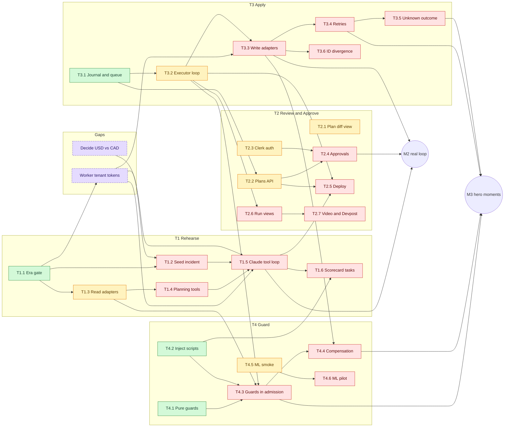
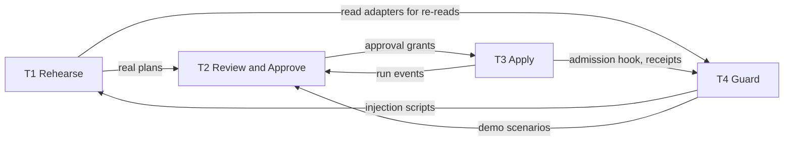

# Blockers

What blocks what, for the whole project, for each track, and for each task. An arrow `A → B` means **B can't finish until A is done**.

**Last updated:** 2026-10-21, after PR #37. Whoever closes a task changes its node's class in the graph and its row below, in the same PR.

## Legend

| Colour | Meaning |
|---|---|
| 🟩 green | Done (issue closed) |
| 🟨 yellow | Ready: nothing blocks it, so someone can start it now |
| 🟥 red | Blocked by something that isn't done |
| 🟪 purple, dashed | A gap: a decision or a piece of work with no issue yet |

## Project-level blockers

These hold back more than one track. Clear them first.

| # | Blocker | Blocks | Why it matters |
|---|---|---|---|
| P1 | **No owners for T1 and T2.** The roster is all TBD, and T1/T2 have had no PRs since the Era gate. | T1.2 to T1.6, all of T2, and so M2 | Every path to the M2 loop goes through T1 and T2. |
| P2 | **Worker tenant tokens** (no issue yet). Era ignores the plain tenant header, so without signed tokens every request lands in tenant `default`. | T1.2, T1.5, T3.3 | Nothing that uses a worker can talk to the right tenant on Era. |
| P3 | **USD vs. CAD.** `policy.v1.json` allows only `cad`; every Era seed charge is USD. | T1.5 and the M2 loop | Every planned refund would be held by policy rule R1. |
| P4 | **Clerk auth (T2.3).** The apply route from #37 refuses every request until it replaces the `noAuth` placeholder. | T2.4, any real apply through the API | Nobody can approve or apply in the real loop. |
| P5 | **Executor loop (T3.2).** | T3.3, T3.6, T4.3, T2.6 | Three tracks plug into it. |

## Task graph

The stretch tasks (T1.7, T1.8, T2.8, T3.7, T4.7) aren't drawn. They come after M3/M4 and are behind the trim decision.

### Critical path to M2

M2 needs three chains to finish. The longest one sets the date:

1. **T1 (longest):** T1.3 read adapters → T1.4 planning tools → T1.5 tool loop, plus tenant tokens, T1.2 seeding and the currency decision. Nobody owns it yet.
2. **T2:** T2.2 plans API and T2.3 Clerk → T2.4 approvals. Nobody owns it yet.
3. **T3:** T3.2 executor loop → T3.3 write adapters (also needs tenant tokens). Owned and moving.

## Track graph

## Per-track blockers

| Track | Owner | Blocked by (outside the track) | Blocks |
|---|---|---|---|
| **T1 Rehearse** | _TBD_ | Tenant tokens (P2), currency decision (P3) | T2 real plans (M2), T4.3 real re-reads, T1.6 scorecard, and T4.2's `SEED`, which should point at the T1.2 cohort |
| **T2 Review & Approve** | _TBD_ | T1.5 for real plans (fixtures work until then); T3.2 for run views | T3 real apply (grants, Clerk auth), deploy, video |
| **T3 Apply** | ArtinMe (per PRs) | Tenant tokens for T3.3; T2.3 and T2.4 for a real apply through the API | T4.3, T4.4, T2.6, M2 |
| **T4 Guard** | skhdemo (per PRs) | T3.2 for T4.3; T1.3 for live re-reads; T1.2 for the real cohort | M3 phantom and conflict moments |

## Task table

| Task | Issue | Status | Waiting on |
|---|---|---|---|
| T1.1 Era gate | [#2](https://github.com/SoroushRF/Rehearsal/issues/2) | done | |
| T1.2 Seed incident + `demo:reset` | [#3](https://github.com/SoroushRF/Rehearsal/issues/3) | blocked | tenant tokens |
| T1.3 Read adapters | [#4](https://github.com/SoroushRF/Rehearsal/issues/4) | ready | owner |
| T1.4 Planning tools | [#5](https://github.com/SoroushRF/Rehearsal/issues/5) | blocked | T1.3 |
| T1.5 Claude tool loop | [#6](https://github.com/SoroushRF/Rehearsal/issues/6) | blocked | T1.2, T1.4, tenant tokens, currency |
| T1.6 Scorecard tasks | [#7](https://github.com/SoroushRF/Rehearsal/issues/7) | blocked | T1.5 |
| T2.1 Plan diff view | [#10](https://github.com/SoroushRF/Rehearsal/issues/10) | ready | owner |
| T2.2 Plans API | [#11](https://github.com/SoroushRF/Rehearsal/issues/11) | ready | owner |
| T2.3 Clerk auth | [#12](https://github.com/SoroushRF/Rehearsal/issues/12) | ready | owner |
| T2.4 Approvals | [#13](https://github.com/SoroushRF/Rehearsal/issues/13) | blocked | T2.2, T2.3 |
| T2.5 Deploy thin slice | [#14](https://github.com/SoroushRF/Rehearsal/issues/14) | blocked | T2.2, T1.5, T3.2 |
| T2.6 Run views | [#15](https://github.com/SoroushRF/Rehearsal/issues/15) | blocked | T3.2 |
| T2.7 Video and Devpost | [#16](https://github.com/SoroushRF/Rehearsal/issues/16) | blocked | T2.6 and the freeze |
| T3.1 Journal, queue, apply route | [#18](https://github.com/SoroushRF/Rehearsal/issues/18) | done | |
| T3.2 Executor loop | [#19](https://github.com/SoroushRF/Rehearsal/issues/19) | ready | |
| T3.3 Write adapters | [#20](https://github.com/SoroushRF/Rehearsal/issues/20) | blocked | T3.2, tenant tokens |
| T3.4 Retries | [#21](https://github.com/SoroushRF/Rehearsal/issues/21) | blocked | T3.3 |
| T3.5 Unknown outcome | [#22](https://github.com/SoroushRF/Rehearsal/issues/22) | blocked | T3.4 |
| T3.6 ID divergence | [#23](https://github.com/SoroushRF/Rehearsal/issues/23) | blocked | T3.3 |
| T4.1 Pure guards | [#25](https://github.com/SoroushRF/Rehearsal/issues/25) | done | |
| T4.2 Inject scripts | [#26](https://github.com/SoroushRF/Rehearsal/issues/26) | done | |
| T4.3 Guards in admission | [#27](https://github.com/SoroushRF/Rehearsal/issues/27) | blocked | T3.2, T1.3 |
| T4.4 Compensation | [#28](https://github.com/SoroushRF/Rehearsal/issues/28) | blocked | T4.3, T3.3 |
| T4.5 ML smoke | [#29](https://github.com/SoroushRF/Rehearsal/issues/29) | ready | |
| T4.6 ML pilot | [#30](https://github.com/SoroushRF/Rehearsal/issues/30) | blocked | T4.5 |
