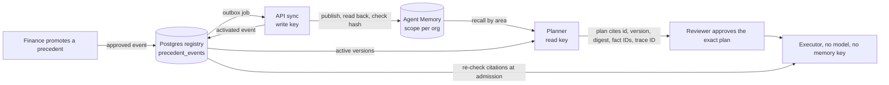

# Rehearsal and SurrealDB Agent Memory (draft for the SurrealDB blog)

**Status: draft.** This answers SurrealDB's questions for their blog post. Facts here are checked against the code on `main`. Evidence is labelled the way the rest of the repository labels it. Items marked **TODO** need the team.

## Rehearsal in one paragraph

Rehearsal is "terraform plan" for AI agents doing batch fintech operations. An agent plans a billing remediation (Stripe refunds, Zendesk ticket updates) inside a simulated copy of the company. A reviewer approves the exact plan once, and the approval is bound to the plan's hash. A deterministic executor, with no model, applies it to the real systems. Before each step it re-checks what the plan assumed, and it holds anything that went stale.

## Where Agent Memory fits

Billing teams make the same judgement calls again and again. For example: "a duplicate charge found within 30 days is refunded in full to the original card". In Rehearsal, finance can promote such a decision from a finished run into a **precedent**. The next time the agent plans a similar case, it recalls the precedent from Agent Memory and cites it in the plan by fact ID. The reviewer then sees why the agent chose what it chose.

One rule shapes everything: **Agent Memory is a recall index, never an authority.** A Postgres registry (`precedent_events`) decides which precedent version is active. Memory helps the planner find precedents. It never approves anything, and the model-free executor never reads it.



## How a precedent is stored

Each precedent is one `concept` entity, `precedent:<id>`. It is written as three attributes in its organization's own scope, `rehearsal/precedents/org-<hash>`. We write with `infer: "triples"`, so no model touches what we store.

```ts
// packages/memory/src/precedent.ts
export function toTriples(record: PrecedentRecord): Triple[] {
  const parsed = PrecedentRecord.parse(record);
  const entity = { type: ENTITY_TYPE, name: entityName(parsed.id) };
  return [
    { entity, key: "statement", value: parsed.statement },
    { entity, key: "version", value: String(parsed.version) },
    { entity, key: "record", value: canonicalize(parsed) },
  ];
}
```

`record` is the canonical JSON (RFC 8785) of the whole precedent: its conditions, exceptions, the dates it's in effect, and the finance lead who approved it. It's the only value readback trusts. `statement` gives recall plain text to match.

The API publishes from an outbox job. It writes, reads the copy back, checks it against the approved version, and only then records the version as active in Postgres:

```ts
// apps/api/src/precedent-sync.ts (trimmed)
return deps.db.transaction(async (tx) => {
  await lockPrecedentMemory(tx, job.orgId, job.precedentId);
  if (await isWithdrawn(tx, job)) return "withdrawn";
  await deps.publisherFor(job.orgId).publish(record); // write, then read back and compare
  await lockPrecedent(tx, job.orgId, job.precedentId);
  const written = await recordPrecedentEvent(tx, { ...job, kind: "activated" });
  return written ? "activated" : "already_active";
});
```

## Recall, then cite by fact ID

When it plans, the planner queries Agent Memory once for each area the registry knows. It treats every hit only as a candidate. It keeps a precedent only when that exact version and content digest is the active one in the registry. Each kept precedent becomes a citation that carries the fact IDs it was read from, plus the trace ID of the query:

```ts
// packages/memory/src/citations.ts (trimmed)
const active = registry.active.get(p.id);
const reason =
  active === undefined ? "not active in the registry"
  : active.version !== p.version ? `registry has version ${active.version}`
  : active.digest !== p.digest ? "content differs from the approved version"
  : null;
if (reason !== null) { dropped.push({ id: p.id, reason }); continue; }
kept.set(p.id, { precedent: p, citation: { id: p.id, version: p.version, digest: p.digest,
  appliesTo: p.record.appliesTo, factIds: p.factIds, traceId: recall.traceId } });
```

The plan's hash covers these citations, so a reviewer approves exactly what was cited.

## How the model-free apply step fits

The executor holds no model key and no memory key. At admission it checks the plan's citations against Postgres alone. If a precedent was withdrawn, superseded or changed after the plan was made, the step is held:

```ts
// packages/core/src/precedents.ts (trimmed)
for (const cited of basis.citations) {
  const active = registry.active.get(cited.id);
  if (active === undefined) holds.push({ ...base, reason: "withdrawn" });
  else if (active.version > cited.version) holds.push({ ...base, reason: "superseded" });
  else if (active.version < cited.version) holds.push({ ...base, reason: "not_active" });
  else if (active.digest !== cited.digest) holds.push({ ...base, reason: "content_changed" });
}
```

The plan also records an epoch for every area it consulted. If a precedent the planner never saw is added or changed in that area, the epoch moves and the plan is held too.

## Which Agent Memory features we used

| SurrealDB asked about | What Rehearsal does |
|---|---|
| Scoping per organization | One scope per organization, `rehearsal/precedents/org-<hash>`. Readback ignores any attribute outside that exact scope. |
| Superseding on withdrawal | When finance withdraws a precedent, a job overwrites its three attributes with a withdrawal marker. Writing the same keys supersedes the approved copy, so recall stops returning it, and `/history` keeps it. Postgres has already dropped it by then; the marker keeps recall tidy. |
| Tracing a memory to its source | Every citation carries fact IDs and the `/query` trace ID. In the review UI, a citation links to the approved version in Postgres, who promoted it and when, and the run it was promoted from. |
| Memory shared across agents | One writer and one reader per organization, each with its own key. The API writes with a write key, the planner reads with a read-only key, and every other process refuses memory keys at startup. We keep it narrow on purpose: memory informs planning and never authorizes execution. |

The keys come from one definition. Both the minting script and the tests use it:

```ts
// packages/memory/src/config.ts
export function memoryKeyGrants(baseScope: string) {
  const below = [`${baseScope}/*`];
  return {
    api: { "memory:read": below, "memory:write": below, "scope:create": below },
    planner: { "memory:read": below },
  } as const;
}
```

## Evidence

Two gates ran against the hosted service on 2026-11-02 and 2026-11-03, three runs each, all passing:
- the memory gate (7/7): publish and read back; recall with fact IDs and a trace ID; `GET /traces/{id}`; replacing v1 with v2, with history kept; scope isolation between keys; a plan citing v1 held once v2 is approved; and the key check, where the API's key publishes and the planner's can recall but not write;
- the app gate (5/5), through the real API routes, the sync job and the planner's job handler: promote → sync → active, the plan cites by fact ID and trace ID, withdraw → approval refused (`409`), and a replan drops the withdrawn copy.

These used a scripted model and testkit planning reads. They were not acceptance runs of a deployed app. Details are in [`docs/agent-memory.md`](agent-memory.md).

## What we learned

[`docs/agent-memory.md`](agent-memory.md) ("Surprises") lists eight behaviours we found while building against the hosted service. Two are examples: `valid_until` is accepted only on relations, so we retire a copy by superseding it instead; and attributes are kept per scope. **TODO (team):** decide which of these to share with SurrealDB.

## For the post

- **Repo:** https://github.com/SoroushRF/Rehearsal
- **Video:** **TODO.** The current video predates Agent Memory; a new one is #16.
- **Architecture diagram:** the diagram above, or the one in the README.
- **Screenshots (TODO, from a real run with memory on):**
  1. the promote panel, where finance promotes a decision from a finished run;
  2. a plan's citation card, with the precedent and its fact IDs;
  3. the citation traced to its approved version, promoter and source run;
  4. a held step after a precedent was withdrawn.
- **Team names, titles and handles: TODO.** GitHub: @SoroushRF, @parsaabbasian, @ArtinMe, @skhdemo.
